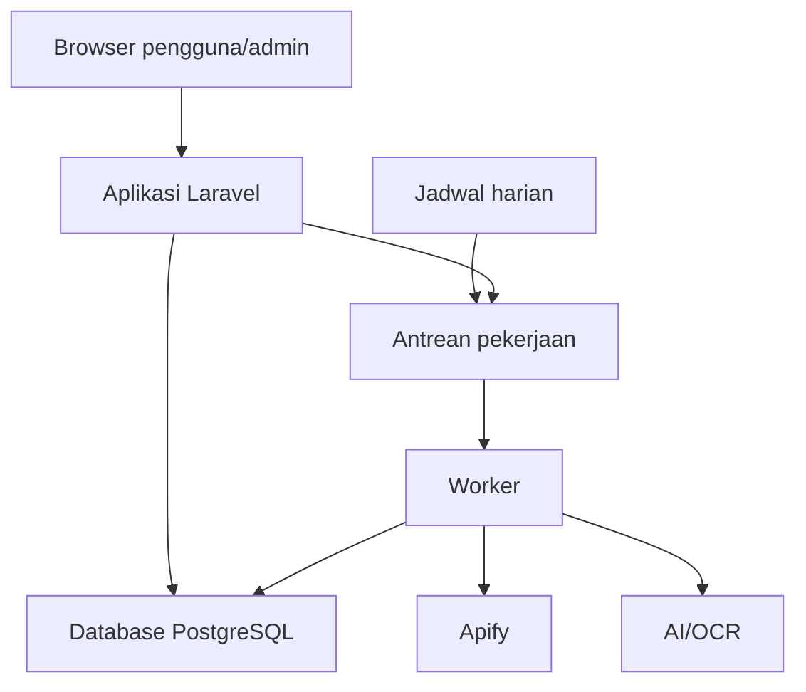

# Cara Kerja Website

## 1. Arah revisi

Rancangan ini mengikuti R1–R15 pada requirements-id.md versi revisi. R10 kini membahas sewa per hari. Nomor properti P01–P20 di bawah menggantikan daftar properti lama; Implementation Plan memakai nomor baru tersebut. Ini adalah rancangan pengembangan, bukan laporan fitur yang sudah dibangun.

Kalkulator, simulasi, target impas, dan halaman rekomendasi terpisah dikeluarkan dari lingkup. Rekomendasi tetap dihitung di belakang layar untuk tiga pilihan di Beranda. Informasi tambahan dibuka sesuai kebutuhan; biaya wajib dan ketentuan sewa tetap jelas.

## 2. Halaman dan bahasa yang digunakan

| Halaman/tindakan | Isi awal | Informasi lanjutan |
|---|---|---|
| Beranda | Maksimal tiga kartu “Pilihan untuk Usaha Anda”, maksimal dua alasan per kartu, “Lihat Semua Bazar”. | Buka detail melalui “Lihat Bazar”. |
| Katalog Bazar | Semua bazar aktif, pencarian, filter sederhana, kartu ringkas. | Filter fasilitas dan pilihan lain dapat dibuka; bazar di luar top tiga tetap ada. |
| Detail Bazar | Nama, tanggal, lokasi, sewa/hari, ketentuan hari/paket, biaya wajib, status dan kontak. | “Informasi Lainnya”: fasilitas, kategori, penyelenggara, sumber dan pemeriksaan. |
| Tersimpan | Bazar pilihan pengguna dengan harga/status terbaru. | Buka detail, Bandingkan, atau “Tulis Pengalaman” setelah selesai. |
| Usaha Saya | Jenis produk, lokasi, jarak, batas sewa/hari, tanggal tersedia. | “Tambahkan Informasi Usaha”: nama, harga produk, fasilitas. |
| Bandingkan | Dua/tiga bazar, tanggal, lokasi/jarak, sewa/hari, hari wajib, fasilitas penting. | Rincian tambahan dapat dibuka; bukan tab utama. |
| Tulis Pengalaman | Keikutsertaan dan pengalaman singkat. | “Tambah Catatan” untuk angka penjualan/biaya opsional. |
| Masuk/Daftar | Email, kata sandi, petunjuk kesalahan sederhana. | Keluar dan hapus akun tersedia pada pengaturan akun. |
| Kelola Bazar (admin) | “Perlu Diperiksa”, “Sudah Tampil”, “Perlu Diperbaiki”. | Form data, sumber, konfirmasi, riwayat perubahan dan pengaturan sumber. |

Navigasi utama: **Beranda · Katalog Bazar · Tersimpan · Usaha Saya**. Pengunjung yang memilih menu pribadi diarahkan ke Masuk dan dapat melanjutkan setelah masuk. Halaman admin terpisah berdasarkan peran, bukan menu utama UMKM.

| Hindari di antarmuka | Gunakan |
|---|---|
| Rekomendasi personal / eligibility | Pilihan untuk Usaha Anda / Sesuai Pilihan Anda |
| Provenance | Sumber Informasi |
| Unknown / insufficient data | Belum ada informasi / Perlu ditanyakan |
| Confidence / completeness / skor 87 | Tidak ditampilkan; sebutkan keterangan yang masih perlu ditanyakan. |
| Ingestion / scraping failed | Informasi belum berhasil diperbarui. Coba lagi nanti. |
| Validation error | Periksa kembali isian yang ditandai. |
| Verified event | Informasi ini sudah diperiksa, pada field yang sesuai. |

Gunakan satu tindakan utama per kartu dan kalimat pendek. Jangan sembunyikan kewajiban paket, biaya tambahan wajib, atau pembatalan di panel tertutup. Angka likes/views dan penjelasan teknis tidak tampil ke UMKM. Istilah teknis di bagian berikut ditujukan untuk pengembang.

## 3. Susunan aplikasi (Architecture)

Stack tetap mengikuti rancangan sebelumnya: satu aplikasi Laravel dengan Blade, Alpine.js, Tailwind CSS dan PostgreSQL. Worker menjalankan pekerjaan pengambilan/AI di latar belakang. Browser membaca data yang sudah disimpan.

Pisahkan modul akun, usaha, katalog, pengelolaan admin, pengambilan data, pengurutan Beranda, alasan singkat, dan catatan pengguna. Hapus modul kalkulator dan simulasi. Controller memvalidasi input; service menghitung aturan; policy memeriksa kepemilikan; tampilan publik hanya menerima field yang diizinkan.

### Urutan pengerjaan: frontend, lalu backend

1. Pasang Laravel sejak awal dan buat seluruh tampilan pengguna/admin langsung di file .blade.php. Gunakan layout dan komponen Blade bersama, Tailwind CSS, Alpine.js, serta data contoh berlabel. HTML ditulis di dalam Blade, sehingga tidak ada tahap konversi HTML terpisah ke Blade. Siapkan route tampilan dan, jika diperlukan, controller sederhana yang hanya mengirim array contoh ke view. Database aplikasi, autentikasi nyata, API bisnis, worker, serta Apify/AI dikerjakan setelah frontend selesai.
2. Simpan layout di resources/views/layouts, komponen di resources/views/components, dan halaman pengguna/admin di resources/views. Sediakan array/fixture contoh untuk bazar, harga, profil, pilihan Beranda, pengalaman dan keadaan gagal. Route di routes/web.php hanya merender halaman selama tahap frontend; controller contoh tidak menyimpan data atau menjalankan aturan bisnis. Atur lingkungan lokal agar halaman contoh dapat dibuka tanpa database aplikasi. Bentuk data ini menjadi kesepakatan untuk integrasi berikutnya.
3. Periksa semua halaman pada 360/768/1280 piksel, keyboard, bahasa sederhana, empat menu, harga/hari, sumber yang bisa dibuka, dan seluruh alur termasuk admin. Semua tombol harus bekerja dalam demonstrasi atau jelas diberi status contoh; tidak boleh mengaku data sudah tersimpan ke layanan nyata.
4. Mulai backend fungsional hanya setelah seluruh checklist frontend lulus dan tidak ada masalah yang menghalangi alur. Lanjutkan proyek Laravel yang sama dengan database, aturan harga/pengurutan, autentikasi/hak akses, pengambilan data dan AI. Laravel tidak dipasang ulang pada tahap ini.
5. Hubungkan halaman Blade yang sudah selesai ke backend pada proyek yang sama. Ganti array contoh dengan data dari controller/service/database, sambungkan form ke tindakan nyata, dan lepaskan simulasi interaksi yang digantikan layanan nyata. Pertahankan layout/komponen, lalu uji alur, keamanan dan kinerja sebelum rilis. Tidak ada pemindahan tampilan dari HTML terpisah.

Kelulusan frontend hanya menutup pekerjaan tampilan/interaksi; acceptance criteria yang memerlukan data tersimpan, otorisasi, scheduler atau layanan nyata tetap menunggu backend dan integrasi.

## 4. Data yang disimpan

| Kelompok | Data dan aturan |
|---|---|
| Akun/sesi | Email unik, password hash, peran, sesi dapat dicabut. |
| Usaha | Kategori, lokasi, radius, batas sewa harian, tanggal, fasilitas; nama/rentang harga opsional; versi profil. Tidak ada kapasitas, margin atau budget total. |
| Bazar/stan | Nama, tempat/koordinat, tanggal, penyelenggara, kategori/fasilitas, status, kontak/deadline; tiap jenis stan memiliki penawaran sendiri. |
| Harga | Nilai sumber integer rupiah; basis daily/package/variable; hari sewa eksplisit; tarif per tanggal bila bervariasi; minimum hari/komitmen paket; biaya wajib terpisah; bukti sumber. |
| Sumber/kandidat | Post ID unik, URL, caption/poster, hasil ekstraksi dan cuplikan bukti, run/status/waktu. |
| Pemeriksaan | Status known/unknown/conflicted per field, konfirmasi admin, sumber/waktu, versi event dan audit perubahan. Known tidak otomatis berarti telah dikonfirmasi. |
| Tersimpan | Unique user+bazar, status/harga dibaca dari data terkini. |
| Pengalaman | Unique user+bazar, teks, angka opsional, bukti privat dan status pemeriksaan. |
| Aturan | Versi aturan pengurutan dan bobot internal. Tidak ada persentase kelengkapan untuk pengguna. |

Tanggal kegiatan memakai WIB; timestamp disimpan UTC. Akhir bazar inklusif hingga awal hari berikutnya. Uang integer pada sumber; pembagian paket dihitung sebagai rasio/decimal tepat, bukan floating point yang mengubah batas anggaran. Null/conflicted tetap belum pasti, bukan nol/false. Terapkan foreign key, constraint unik, transaksi publish/merge dan audit, serta pemeriksaan versi untuk edit bersamaan.

## 5. Harga sewa harian

Harga harian langsung memakai nilai yang dinyatakan penyelenggara. Paket hanya dapat dinormalisasi jika jumlah hari sewa yang dicakup dinyatakan jelas, bukan sekadar selisih tanggal bazar. Paket Rp450.000 untuk tiga hari tampil **“Setara Rp150.000/hari”**, **“Wajib sewa 3 hari”**, dan harga paket asli Rp450.000. Ini bukan kalkulator pengguna: hanya aturan penyajian harga dari sumber.

Untuk paket P selama D hari, bandingkan P dengan budget_harian × D sehingga pembulatan tidak mengubah hasil. Tampilan ceil(P/D) rupiah. Paket Rp100.000/3 hari tampil Rp33.334/hari; budget Rp33.333 gagal, Rp33.334 lolos. Jika D tidak diketahui, tampilkan “Tanyakan harga sewa”. Gratis hanya dari sumber yang eksplisit.

Tarif bervariasi ditampilkan sebagai rentang; cek budget terhadap tarif tertinggi selama periode partisipasi wajib. Jika katalog memakai “Mulai Rp…/hari”, nilainya harus berasal dari penawaran nyata yang tersedia; pilihan personal memakai penawaran sesuai jenis usaha. Tampilkan ketentuan hari minimum dan biaya wajib yang diketahui; biaya tambahan belum jelas diberi keterangan. Kecocokan budget hanya membahas sewa, bukan total biaya berjualan. Tidak ada input transportasi, margin atau simulasi biaya.

## 6. Beranda, katalog, dan alasan

Untuk personalisasi, syarat wajib adalah kategori diterima, seluruh hari partisipasi tercakup tanggal pengguna, jarak dalam radius, sewa harian dalam budget, fasilitas wajib terpenuhi, dan pendaftaran terbuka. Gunakan tiga hasil internal: sesuai, tidak sesuai, atau belum pasti. Satu ketidakcocokan pasti mengalahkan data kosong. Data wajib belum pasti tidak masuk top tiga, tetapi tetap dapat dilihat di katalog.

Haversine memakai radius bumi 6.371 km; filter memakai jarak mentah, tampilan satu desimal berlabel garis lurus. Nilai tiap penawaran stan dievaluasi terpisah; pilih penawaran sesuai dengan skor tertinggi, seri berdasarkan ID penawaran.

| Faktor internal v2 | Bobot | Nilai 0–1 |
|---|---:|---|
| Jenis produk | 20 | 1 jika cocok. |
| Tanggal tersedia | 15 | 1 jika semua hari tercakup. |
| Fasilitas wajib | 10 | 1 jika terpenuhi atau tidak ada kebutuhan fasilitas. |
| Jarak | 20 | clamp(1 − jarak/radius, 0, 1). |
| Sewa harian | 20 | clamp(1 − sewa_harian/budget_harian, 0, 1); budget nol dan sewa gratis terkonfirmasi bernilai 1. |
| Kisaran harga produk | 15 | 1 bila rentang harga pengguna dan sasaran pembeli dari sumber beririsan; jika salah satu belum ada/tidak cocok, 0. |

Skor internal dibulatkan dua desimal dan dipakai untuk urutan menurun; seri memakai tanggal mulai lalu UUID secara leksikografis. Bobot data hilang tidak dibagikan ulang. Skor, bobot, dan kelengkapan tidak dikirim dalam tampilan UMKM. Likes dan catatan penjualan tidak masuk pengurutan. Setelah memilih tiga teratas, katalog tetap menampilkan seluruh bazar aktif, termasuk ketiganya.

Beranda pengguna keluar/profil belum lengkap menampilkan maksimal tiga “Bazar Mendatang” menurut tanggal lalu ID, bukan klaim personal. Jika pengguna lengkap tidak punya hasil cocok, tampilkan “Belum ada bazar yang sesuai” dan tautan katalog; jangan mengisi dengan data yang belum pasti.

Alasan dibangun dari daftar fakta dan kode alasan sah. AI hanya memilih/mengurutkan kode; server merender kalimat Indonesia dengan nilai sumber. Kartu menampilkan dua alasan teratas, detail menyediakan alasan lainnya. Peringatan wajib berdiri terpisah dan tidak dibatasi dua. Skor/urutan bazar sudah tersedia sebelum permintaan AI; timeout/output invalid memakai alasan standar. Jangan kirim email, koordinat asal atau catatan keuangan ke AI.

## 7. Alur data dan layanan

Pengambilan harian 02.00 WIB per sumber aktif memakai lock dan run unik per hari; run manual terpisah. Apify berjalan asinkron, status diperiksa oleh job singkat, dataset dibaca berhalaman. Upsert post ID mencegah duplikasi. AI/OCR menghasilkan kandidat dan bukti, lalu admin meninjau sebelum publikasi. Perubahan sumber tidak otomatis menimpa data publik atau waktu pemeriksaan admin.

Timeout request provider 30 detik, job ekstraksi 120 detik, maksimum tiga percobaan dengan backoff untuk gangguan sementara, dan deadline run Apify 15 menit. Kegagalan tampil sederhana bagi admin, dengan rincian kode di log pengembang. Pencarian dan Beranda tetap membaca database.

| Jalur | Perilaku |
|---|---|
| GET / | Beranda dan maksimal tiga pilihan; tidak menunggu provider. |
| GET /events, /events/{id} | Katalog lengkap/detail dengan harga per hari dan sumber. |
| PUT /me/profile | Simpan Usaha Saya dan naikkan versi profil. |
| POST /events/{id}/explanation | Alasan dari fakta; AI opsional, tidak membuat halaman rekomendasi. |
| POST /compare | Validasi 2–3 ID berbeda dan tampilkan tabel singkat. |
| PUT/DELETE /me/saved-events/{id} | Simpan/hapus pilihan pemilik tanpa duplikasi. |
| POST/PUT/DELETE /me/evaluations/{id} | Pengalaman pemilik sesudah bazar selesai. |
| POST /events/{id}/reports | Laporan koreksi untuk admin. |
| /admin/* | Pengelolaan sumber, kandidat, bazar dan pemeriksaan. |
| /register, /login, /logout; DELETE /me/account | Akun, sesi, dan penghapusan data. |

Tidak ada route/modul kalkulator atau simulasi untuk instalasi baru. Bila versi lama sudah dibangun, GET halaman rekomendasi lama diarahkan ke Beranda; halaman kalkulator lama menjelaskan fitur sudah dihapus tanpa kontrol interaktif, dan endpoint kalkulasi/simulasi lama ditolak (410). Hapus tautan, pemanggilan API dan pekerjaan terkait dari alur aktif. Tidak perlu memigrasikan data simulasi ke fitur lain. Jika data lama benar-benar ada, tetapkan penghapusan terkontrol dan pastikan hapus akun juga mencakup data itu; rencana ini tidak mengklaim database telah diubah.

## 8. Data pribadi dan kesiapan rilis

Gunakan sesi Secure/HttpOnly/SameSite, regenerasi sesi login, CSRF, hash kata sandi, policy server, HTTPS, dan limiter login lima percobaan per menit email+IP dengan limiter IP tambahan. Input/tautan di-validasi, output di-escape; unduhan poster dibatasi host, tipe, ukuran dan tidak mengakses jaringan privat. Rahasia hanya di environment server.

Penghapusan akun mencakup profil, bookmark, pengalaman/bukti, cache dan semua sesi; job tertunda tidak boleh membuat ulang data pengguna terhapus. Log tidak memuat rahasia atau keuangan pribadi. Backup maksimal 30 hari, dan daftar penghapusan diterapkan sebelum restore boleh dipakai. Admin mengakses data pribadi hanya untuk tugas pengelolaan.

Uji p95 server ≤2 detik untuk 500 bazar/20 pengguna pada Beranda, katalog, detail, filter dan urutan. Gunakan index dan pagination 20 item. Siapkan worker, scheduler, health check, migrasi, HTTPS, README dan repo publik tanpa rahasia. Data demo berlabel “Contoh”. Seluruh teks, termasuk admin/error, ditinjau agar formal dan sederhana.

# Hal yang Harus Selalu Benar (Correctness Properties)

Properti berikut adalah aturan yang harus diuji, bukan hasil uji yang sudah lulus. Rn.ACm merujuk ke acceptance criteria pada requirements-id.md revisi. P01–P20 adalah nomor baru untuk revisi ini.

| ID | Properti | Validasi | Requirement |
|---|---|---|---|
| P01 — Akun dan sesi aman | Email unik, akses data sesuai pemilik/peran, dan sesi keluar tidak dapat digunakan lagi. | Uji dua pengguna, admin, URL langsung, role palsu, email duplikat, dan cookie setelah logout. | R1.AC1–3, R13.AC1–2 |
| P02 — Profil singkat dan valid | Data wajib lengkap sebelum pilihan personal; nilai kosong bukan nol; perubahan profil memengaruhi Beranda. | Uji radius nol, sewa negatif/nol, tanggal/harga terbalik, koordinat invalid, dan perubahan profil. | R2.AC1–4 |
| P03 — Pengambilan tidak menggandakan data | Satu unggahan memiliki satu identitas; pengambilan harian tidak berganda dan tidak dipicu pencarian. | Jalankan dua worker/retry untuk unggahan sama; pastikan sumber nonaktif dilewati dan run tercatat. | R3.AC1–2 |
| P04 — Informasi tanpa bukti tetap belum pasti | Ekstraksi tidak menebak informasi dan tidak langsung mengubah bazar publik. | Uji poster parsial, tanggal ambigu, JSON rusak, dan instruksi berbahaya dalam caption; cek antrean admin. | R3.AC3, R4.AC3 |
| P05 — Publikasi dan penggabungan aman | Hanya data wajib valid yang diterbitkan; konflik penting terselesaikan; sumber, catatan pengguna, dan audit tidak hilang. | Hilangkan tiap field wajib, uji edit bersamaan/rollback, merge dengan bookmark/evaluasi ganda, dan verifikasi per field. | R4.AC1–4 |
| P06 — Katalog lengkap dan filter jujur | Katalog memuat semua bazar aktif termasuk di luar top tiga; mismatch ditolak dan data tidak pasti dipisahkan. | Gunakan lima bazar cocok, status canceled/ended/withdrawn, harga kosong, hasil kosong, dan tanggal tepat batas akhir WIB. | R5.AC1–4 |
| P07 — Jarak dihitung dengan benar | Jarak simetris, nonnegatif dan nol untuk titik sama; filter memakai nilai mentah dan label garis lurus. | Uji koordinat referensi dan radius tepat di bawah/sama/di atas jarak; toleransi hitungan 0,001 km. | R5.AC4, R7.AC2 |
| P08 — Detail ringkas tanpa kehilangan informasi penting | Informasi tambahan dapat dibuka; biaya wajib, paket, ketidakpastian dan pembatalan tidak tersembunyi; laporan tidak mengubah data. | Periksa kartu/detail/compare dan sumber; uji warning tepat tujuh hari dan sesudahnya serta submit laporan. | R5.AC2, R6.AC1–4, R14.AC3 |
| P09 — Beranda maksimal tiga pilihan yang sesuai | Pilihan personal hanya eligible dan berbeda; fallback umum tidak mengaku personal; tidak ada halaman rekomendasi terpisah. | Uji 0/1/2/3/5 hasil, pengguna keluar/profil kurang, unknown wajib, pendaftaran tutup; periksa navigasi dan katalog lengkap. | R7.AC1–4, R14.AC1 |
| P10 — Pengurutan tetap dan dapat diulang | Skor internal 0–100, bobot 100, missing tanpa kredit; input sama memberi urutan sama, tanpa pengaruh sosial atau laporan penjualan. | Uji komponen acak, budget nol, seri skor/tanggal/ID, input diacak, likes diubah, dan pergantian versi aturan. | R7.AC3 |
| P11 — Alasan singkat dan bersumber | Maksimal dua alasan di kartu; semua klaim sah; peringatan tetap terlihat; AI tidak mengubah angka/urutan bazar. | Uji reason code palsu, timeout, JSON invalid dan fakta hilang; fallback tetap tampil dan rincian tersedia. | R8.AC1–3 |
| P12 — Perbandingan sederhana | Hanya 2–3 bazar berbeda, harga harian dan syarat jelas, tanpa skor, dan tindakan tetap berfungsi di ponsel. | Uji 1/2/3/4 ID, duplikat, hapus pilihan, detail, serta harga harian vs paket pada layar 360 piksel. | R9.AC1–3 |
| P13 — Harga per hari tidak menyesatkan | Harga paket dibagi hanya dengan hari sewa yang jelas; nilai asli dan syarat wajib tampil; rentang memakai tarif tertinggi untuk filter. | Rp450.000/3 hari→Setara Rp150.000/hari, wajib 3 hari; hari tidak jelas→Tanyakan harga; Rp100.000–Rp200.000/hari ditolak untuk budget Rp150.000. | R10.AC1–4, R4.AC2, R7.AC2 |
| P14 — Pembulatan tidak mengubah hasil filter | Bandingkan nilai harian tepat; tampilan dibulatkan ke atas; gratis perlu bukti dan biaya tambahan tidak dianggap termasuk sewa. | Paket Rp100.000/3 hari tampil Setara Rp33.334/hari, gagal budget Rp33.333, lolos Rp33.334; uji biaya tambahan unknown dan harga nol. | R10.AC1–4 |
| P15 — Tersimpan hanya untuk bazar | Bookmark unik dan persisten, status/harga terbaru; tidak ada simulasi atau jalur kalkulator aktif. | PUT berulang, login ulang, perubahan harga/status; pastikan tautan kalkulator tidak ada dan endpoint lama tidak berjalan. | R11.AC1–3, R14.AC1 |
| P16 — Pengalaman tetap pribadi | Satu catatan per bazar setelah selesai; angka opsional dan privat; verified memerlukan bukti admin. | Uji batas waktu, duplikat, edit/delete, rentang salah, pembukaan Tambah Catatan, akses silang dan ringkasan publik. | R12.AC1–3 |
| P17 — Penghapusan akun menyeluruh | Sesi, profil, bookmark, pengalaman/bukti dan cache pribadi terhapus; job/restore tidak mengembalikan data. | Uji beberapa sesi, job berjalan, backup restore dan penghapusan data lama jika ada. | R13.AC3 |
| P18 — Bahasa dan tampilan mudah digunakan | Semua halaman memakai istilah sederhana, navigasi empat menu, informasi bertahap, dan akses keyboard/ponsel. | Audit teks seluruh halaman termasuk admin dan error; uji 360/768/1280, fokus/label/alt, rupiah/WIB dan keadaan kosong/gagal. | R14.AC1–4, R6.AC4 |
| P19 — Website tetap cepat saat layanan gagal | Request inti tidak memanggil Apify/AI; data terakhir tetap ada dan tidak ada rahasia/data pribadi keluar lewat payload/log. | Uji provider down/429, retry, secret sentinel, HTTPS/limiter, dan 500 bazar/20 pengguna; p95 server ≤2 detik. | R3.AC4, R13.AC2, R13.AC4, R15.AC1–2 |
| P20 — Rilis bisa dijalankan dan diperiksa | URL live, petunjuk setup, repo tanpa rahasia, dan label Contoh tersedia. | Fresh setup, smoke test live, pemeriksaan repo serta label pada data demo. | R15.AC3 |

Simpan test ID, property ID, requirement/AC, input atau seed, hasil, dan bukti yang relevan. Seluruh R1–R15 tercakup oleh tabel ini; verifikasi lengkap dilakukan sebelum rilis.